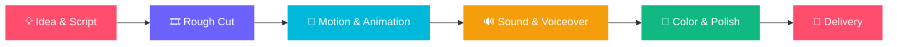

<!-- ===================== HEADER ===================== -->
<div align="center">


<a href="https://awaisanjum.com">
  
</a>

<br/>

<a href="https://awaisanjum.com"></a>
<a href="https://www.linkedin.com/in/awais-anjum/"></a>
<a href="mailto:awaisanjum515@gmail.com"></a>

<br/><br/>


</div>

<br/>

<!-- ===================== ABOUT ===================== -->
## 🎬 About Me

```text
> whoami
Awais Anjum — a video editor who cuts story-first.

> experience --years
3+

> range --niches
26

> status
Open to freelance & full-time work
```

I turn raw footage into stories people actually finish watching. Over 3+ years I've edited across an unusually wide range of niches, so I can adapt pacing, tone and visual language to whatever a story needs: **cinematic** for documentaries, **punchy** for reels, **clean** for explainers.

<div align="center">

| 🎞️ **3+** | 🎯 **26** | 📖 **100%** |
|:---:|:---:|:---:|
| Years of experience | Niches covered | Story-first editing |

</div>

<br/>

<!-- ===================== NICHES ===================== -->
## 🧭 Niche Timeline

<div align="center">


</div>

<br/>

<!-- ===================== TOOLKIT ===================== -->
## 🛠️ Toolkit

<div align="center">


<br/>


</div>

<br/>

<!-- ===================== WORKFLOW ===================== -->
## ⚡ How I Work



<br/>

<!-- ===================== CURRENTLY ===================== -->
## 🌱 Currently

- 🎥 Taking on freelance video editing projects
- 🇩🇪 Learning German (Deutsch)
- 🧪 Experimenting with storytelling-driven documentary and explainer formats
- 📬 Open to full-time and freelance opportunities

<br/>

<!-- ===================== GITHUB STATS (optional) ===================== -->
## 📊 GitHub Stats

<div align="center">


<br/>


</div>

<br/>

<!-- ===================== CONTACT ===================== -->
## 💬 Let's Cut Something Great Together

Have a project in mind? Share your idea and vision, and I'll handle the rest.

<div align="center">

<a href="https://awaisanjum.com"></a>
<a href="mailto:awaisanjum515@gmail.com"></a>
<a href="https://www.linkedin.com/in/awais-anjum/"></a>

</div>


